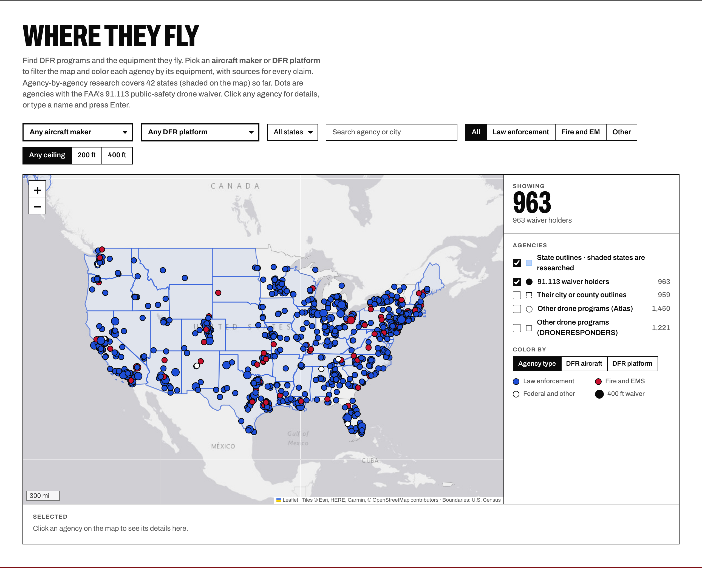
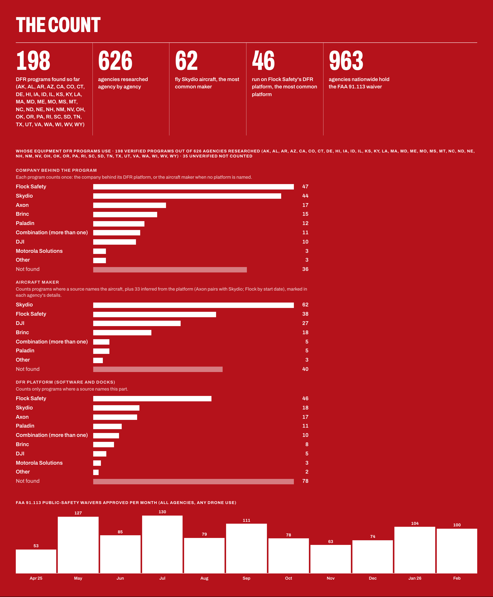
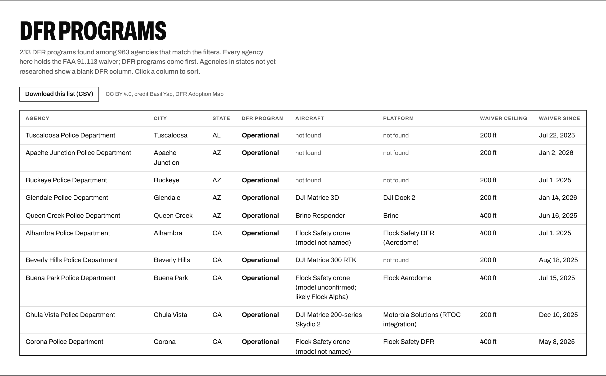
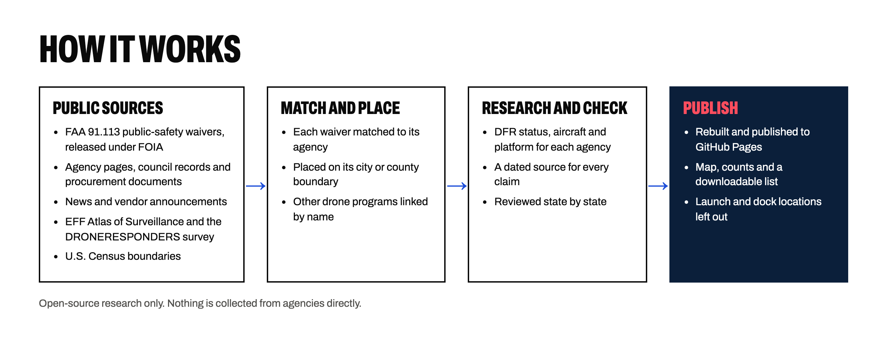

An open map of the U.S. public safety agencies approved to fly drones as first responders (DFR), and the aircraft and platforms behind their programs.

**[Open the live map →](https://basilbuildsai.github.io/dfr-program-map/)**

Drone as first responder means a drone launches on a 911 call and reaches the scene before officers do, sending live video back so they arrive knowing what they face. From April 2025 to February 2026 the FAA approved 1,004 public-safety waivers for 963 agencies. Holding the waiver is only the start, and there's no public list of who actually runs DFR or what they fly. This map starts from the FAA list and checks each agency against public records.

This repository holds the published page and its data. The map is rebuilt and published automatically as research is checked.

## What it shows

- **Every FAA 91.113 waiver holder.** 963 police, sheriff, fire, emergency management and federal agencies, placed on their city or county boundary, with each waiver's 200 ft or 400 ft ceiling and dates.
- **DFR programs, verified agency by agency.** 626 agencies researched in 42 states so far, and 198 verified DFR programs. Each agency is marked operational, pilot, approved or purchased, planned, handheld drones only, or no public evidence.
- **The equipment.** The aircraft maker and DFR platform behind each program, with a dated source for every claim. Filter the map or color it by aircraft or platform.
- **Other drone programs** from the EFF Atlas of Surveillance (1,450) and the DRONERESPONDERS survey (1,221) as optional layers.
- **The count.** Totals, the equipment behind verified programs, and waivers approved by month.
- **A list of every agency**, sortable, with a CSV download.

## How it works

Research uses only public sources: agency websites, council agendas and staff reports, procurement records, news coverage and vendor announcements. An agency counts as a DFR program only when a dated source shows it. Where a source names the platform but not the aircraft, the aircraft may be inferred and is marked that way in the agency's details. States are reviewed before their results are counted. Launch and dock locations are deliberately left off the map.

## Files

| Path | What it is |
|---|---|
| `index.html` | The page: layout, styles and map code (Leaflet from cdnjs) |
| `data.js` | Every waiver holder with its waivers, research record and sources, plus the Atlas and DRONERESPONDERS programs |
| `boundaries.json` | Simplified city, township and county outlines for each agency (U.S. Census 2024 cartographic boundaries) |
| `states.json` | State outlines (U.S. Census 1:20m) |
| `hero.jpg` | Title photo |
| `readme/` | The images in this README, drawn in the same style as the page |

To run it locally, serve the folder with any static web server, for example `python3 -m http.server`, and open `http://localhost:8000`.

## Sources

- **FAA 91.113 public-safety waivers**, April 2025 to February 2026, released under FOIA and published by the [Electronic Frontier Foundation](https://www.eff.org/deeplinks/2026/07/hundreds-drone-first-responder-programs-could-soon-be-launched-across-country).
- **[EFF Atlas of Surveillance](https://atlasofsurveillance.org)** drone entries.
- **DRONERESPONDERS** public safety UAS survey.
- **U.S. Census Bureau** 2024 gazetteer and cartographic boundary files.
- **Open-source research**: agency, council, procurement, news and vendor sources, linked from each agency on the map.

## Help improve it

Spotted a program that's missing, out of date or wrong? [Open an issue](https://github.com/basilbuildsai/dfr-program-map/issues) with the agency and a link to a public source, or message me on [LinkedIn](https://www.linkedin.com/in/basil-yap-461b1975/).

## License

**Content and data**: Creative Commons Attribution 4.0 (CC BY 4.0), see `LICENSE.txt`. Credit as Basil Yap, DFR Adoption Map, https://basilbuildsai.github.io/dfr-program-map/.

Sources belong to their publishers. The map links to them and does not host them.

## Built by

Basil Yap. I've spent 17 years helping drones and advanced air mobility aircraft into the national airspace. Other open projects include the [U.S. AAM Resource Map](https://basilbuildsai.github.io/aam-resource-map/) and the [AAM Fleet Registry](https://basilbuildsai.github.io/aam-fleet-registry/).
